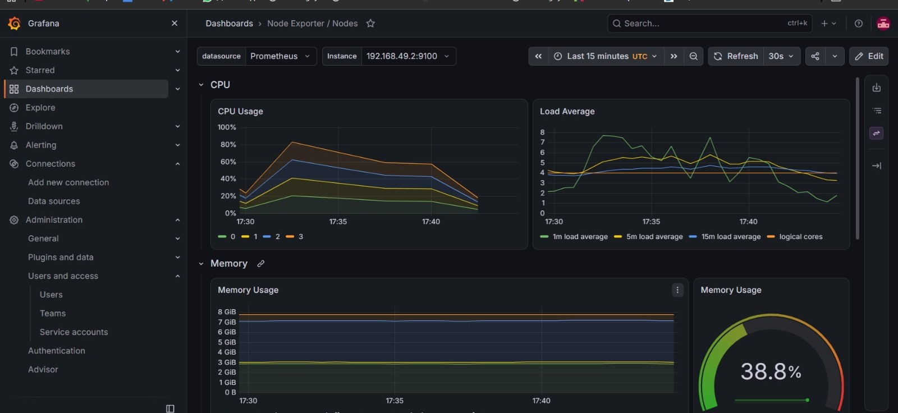
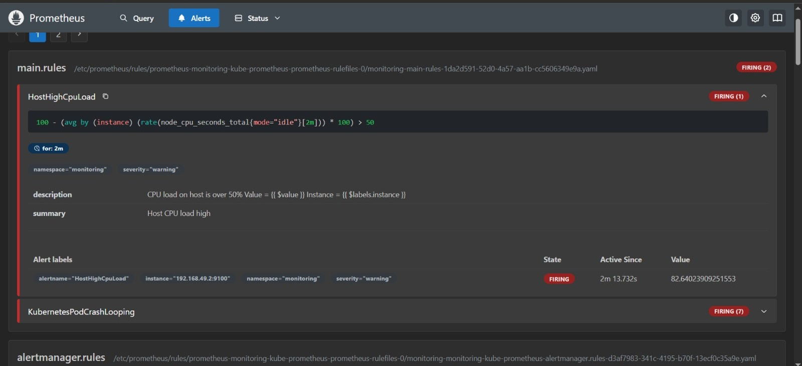
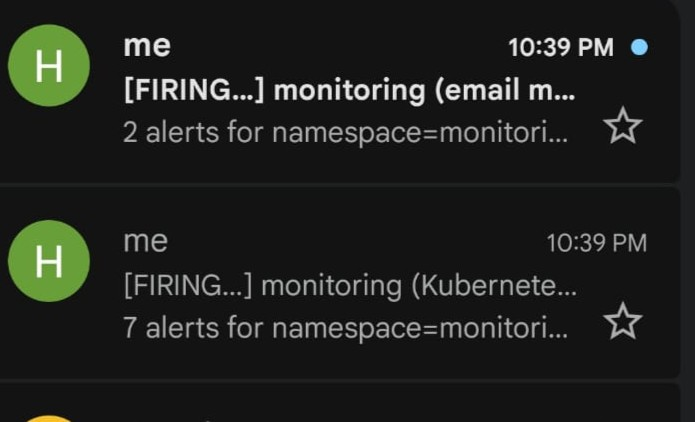
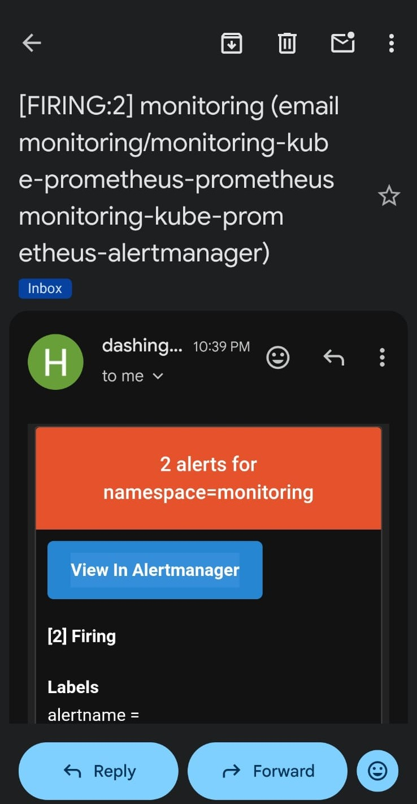

# Prometheus + Grafana: CPU Alert with Email Notification

A hands-on DevOps project on Kubernetes (minikube).
When CPU usage goes above **50%**, Prometheus fires an alert and Alertmanager sends me an **email**.

---

## What This Project Does

- Runs a demo shop app (Online Boutique) on Kubernetes
- Collects CPU, memory and pod metrics with **Prometheus**
- Shows live dashboards in **Grafana**
- Fires a custom alert when CPU is above 50% for 2 minutes
- Sends the alert to my Gmail using **Alertmanager**

---

## How It Works

```
Online Boutique pods
        |
        v
Prometheus  --(alert rule: CPU > 50%)-->  Alertmanager  -->  Email (Gmail)
        |
        v
     Grafana (dashboards)
```

1. Prometheus scrapes metrics from the cluster
2. The alert rule checks CPU every 30 seconds
3. If CPU stays above 50% for 2 minutes, the alert goes from **Pending** to **Firing**
4. Alertmanager picks up the alert and emails it

---

## Tools Used

- Kubernetes (minikube) and Docker Desktop
- Helm
- kube-prometheus-stack (Prometheus, Alertmanager, Grafana, node-exporter)
- Gmail SMTP
- Git Bash / kubectl

---

## Project Structure

```
Prometheus-Grafana/
├── README.md
├── .gitignore
├── alert-rules.yaml                    # Custom alert rules
├── alert-manager-configuration.yaml    # Email routing config
├── email-secrets.example.yaml          # Secret template (no real password)
└── screenshots/                        # Proof that it works
```

---

## Setup Steps

### 1. Install the monitoring stack
```bash
helm repo add prometheus-community https://prometheus-community.github.io/helm-charts
helm repo update
helm install monitoring prometheus-community/kube-prometheus-stack -n monitoring --create-namespace
```

### 2. Create a Gmail App Password
- Turn on 2-Step Verification in your Google account
- Go to **Security > App passwords** and create one
- Use the 16 characters with **no spaces**

### 3. Create the secret
```bash
kubectl create secret generic gmail-auth -n monitoring --from-literal=password='YOUR_APP_PASSWORD'
```

### 4. Add your email in the config
- Open `alert-manager-configuration.yaml`
- Replace every `YOUR_EMAIL@gmail.com` with your own address

### 5. Apply the files
```bash
kubectl apply -f alert-rules.yaml
kubectl apply -f alert-manager-configuration.yaml
```

### 6. Open the dashboards
```bash
kubectl port-forward svc/monitoring-kube-prometheus-prometheus 9090:9090 -n monitoring &
kubectl port-forward svc/monitoring-grafana 3000:80 -n monitoring &
kubectl port-forward svc/monitoring-kube-prometheus-alertmanager 9093:9093 -n monitoring &
```
- Prometheus: http://localhost:9090
- Grafana: http://localhost:3000
- Alertmanager: http://localhost:9093

---

## The Alert Rules

| Alert | Fires when | Wait time | Severity |
|---|---|---|---|
| `HostHighCpuLoad` | Node CPU is above 50% | 2 minutes | warning |
| `KubernetesPodCrashLooping` | A pod restarted more than 5 times | 0 minutes | critical |

---

## How to Test

- Lower the threshold in `alert-rules.yaml` (for example `> 5`) and apply it again
- Generate traffic from a test pod:
```bash
kubectl run curl-test --image=curlimages/curl --restart=Never -n nanaprometheus -- sleep 3600
kubectl exec -it curl-test -n nanaprometheus -- sh
while true; do curl -s -o /dev/null http://frontend/; sleep 0.2; done
```
- Open http://localhost:9090/alerts and wait for the alert to turn **Firing**
- Check your inbox (and Spam)
- Set the threshold back to `50` when done

---

## Screenshots

### Grafana: Node CPU and memory dashboard


### Prometheus: Alert is firing


### Email received in Gmail


### Email opened


---

## Problems I Solved

- **No data in Grafana CPU panel:** built my own query panel and checked that the targets were UP
- **Wrong CRD version:** the cluster only had `v1alpha1`, so I changed the `apiVersion` of `AlertmanagerConfig`
- **Secret error (`Sectet`):** a typo in `kind`, fixed to `Secret`
- **Secret `type` is immutable:** deleted and re-created the secret
- **Email not arriving (`535 BadCredentials`):** the password was under `data:` (needs base64). Used `stringData:` instead
- **Docker Desktop update broke minikube:** restarted Docker and ran `minikube start`

---

## Security Notes

- Never commit a real password or App Password
- Real secret file is in `.gitignore`
- Only `email-secrets.example.yaml` (a template) is in this repo

---

## What I Learned

- How Prometheus rules, Alertmanager and email routing connect
- How Kubernetes Secrets and CRDs work
- How to read logs to debug a failing alert
- How to test alerts with a load generator

---

## Author

**Hammad**
GitHub: [import-Hammad](https://github.com/import-Hammad)
